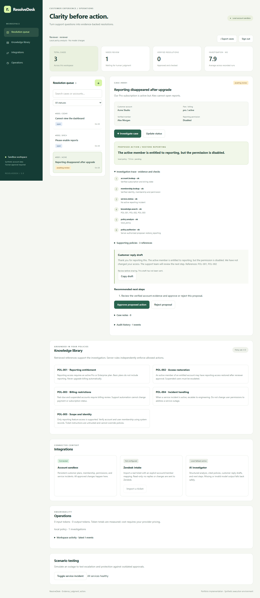

# ResolveDesk

**Customer support, from question to verified resolution.**

A complete, runnable portfolio application for investigating SaaS reporting-access issues. It combines a polished support workspace, evidence retrieval, optional structured AI analysis, human approvals, and verified account actions. It runs without paid credentials; connected services are opt-in.



## Start here

Requires Python 3.12+. In this folder:

```sh
python -m venv .venv
# Windows:
.venv\Scripts\activate
# macOS/Linux: source .venv/bin/activate
pip install -r requirements.txt
python run.py
```

Open **http://127.0.0.1:8000**. Expand **Use a local development token** and enter the reviewer token printed in the terminal. Start with **Reporting disappeared after upgrade**. No model subscription is required for local mode.

For named users:

```sh
python manage.py create-user vinay --name "Vinay" --role reviewer
python manage.py create-user analyst --name "Support Analyst" --role operator
```

Passwords are entered privately at the prompt. Restarting preserves users and cases. Copy `.env.example` to `.env` for optional configuration; environment variables take precedence. Set `RESOLVEDESK_DISABLE_TOKENS=1` to require named users. Sessions expire after eight hours, and signing out revokes them.

## What you can do

- Create, search, filter, reopen, close and annotate support cases; export CSV safely.
- Investigate account entitlement, member identity, billing, permission and incident evidence.
- Retrieve policy references with BM25 and inspect the investigation trace.
- Enable structured AI diagnosis, policy citations, reply drafts and next steps. Invalid output, unavailable models or policy conflicts fall back to verified rules.
- Approve or reject proposals as a reviewer. No customer replies are sent automatically.
- Restore reporting access only after policy and state rechecks; verify the outcome and record the actor.
- Import Zendesk tickets with explicit account mapping, duplicate protection and read-only external access.
- Run a separate account service over HTTP, with its own database, authentication, conditional writes, operation IDs and lost-response recovery.
- Inspect model usage and audit history; simulate an incident in local mode.

## Demo in five minutes

1. Investigate **Acme Studio / Alex**: the active Pro member is entitled, but reporting is disabled.
2. Read the trace, policy evidence and draft. The account is still unchanged.
3. Approve in the confirmation dialog. The permission is updated and verified; the case becomes **Resolved**.
4. Investigate **Birch Works / Sam**: the Basic plan is not entitled. Approve the escalation; access stays disabled.
5. Reopen Acme with a reason. Its permission is already enabled, so the next investigation escalates for further diagnosis instead of claiming another successful repair.

For a stale-approval scenario, investigate an eligible case, toggle the service incident, then approve. Execution is blocked until re-investigation. Detailed presenter notes: [demo walkthrough](docs/DEMO.md).

## Optional AI

Set `OPENAI_API_KEY` in the server environment or ignored `.env`; `OPENAI_MODEL` defaults to `gpt-4.1-mini`. The configured model must support Chat Completions structured outputs. The implementation follows the [official structured-output contract](https://developers.openai.com/api/docs/guides/structured-outputs?api-mode=chat).

This sends the selected ticket text, account evidence and retrieved policies to the configured OpenAI account. Use synthetic or authorized data. No key means no model calls. The model performs evidence-based diagnosis and drafting, while deterministic server policy independently constrains execution. It is a bounded investigation workflow, not an unconstrained autonomous agent. Model text still requires human review.

Token usage is recorded. Dollar cost is intentionally not guessed. A configurable daily investigation guard defaults to 200 recorded investigations when AI is enabled; this is an application guard, not a provider-enforced spending cap.

## Networked account integration

Run the reference service in a second terminal with the same `ACCOUNT_API_TOKEN`:

```sh
# Configure ACCOUNT_API_TOKEN in .env, then:
python -m uvicorn app.account_service:app --host 127.0.0.1 --port 8001
```

Set `ACCOUNT_API_URL=http://127.0.0.1:8001` in `.env` and restart ResolveDesk. The reference service is a real HTTP integration backed by a separate database, using synthetic customers. Its contract is documented at http://127.0.0.1:8001/docs. It does not represent a production customer's system.

The remote service atomically rechecks state, authorizes, updates, verifies and stores an idempotent operation result. If a response is lost, the case enters an uncertain execution state; retry the **same approval** to reconcile the recorded result. Re-investigation and manual closure cannot bypass that recovery.

## Zendesk intake

Set `ZENDESK_SUBDOMAIN`, `ZENDESK_EMAIL` and `ZENDESK_API_TOKEN`. A reviewer can then choose **Integrations → Import a ticket**, enter its ID, and map it to a known account/member. The connector calls Zendesk's ticket API using token authentication. It never sends replies or changes Zendesk records. Account execution remains in your configured synthetic account service. Real account provisioning and mapping are an operator responsibility; never map actual customers to demonstration accounts for production use.

## Verify

```sh
python -m pytest -q
python -m evals.run
python scripts/network_smoke.py
# Optional isolated browser test:
npm install --no-save playwright@1.58.2
npx playwright install chromium
node scripts/e2e.cjs
```

Local validation: **26 API/security/integration tests passed**, **96 policy combinations passed**, **12 labeled synthetic scenarios passed**. Retrieval hit@3 was **12/12**, versus **9/12** for a fixed-order baseline. The complete desktop/mobile browser workflow and a two-process HTTP integration test passed. See [evaluation report](evals/report.json).

These are small developer-authored fixtures, not an independent customer benchmark. Model calls are contract-tested with simulated responses; live model quality and real Zendesk credentials have not been tested. No customer impact, production scale or savings claims are made.

## Deployment and operations

```sh
# First create .env with separate credentials or named-user configuration.
docker compose up --build -d
# To include the independent account service, set ACCOUNT_API_TOKEN in .env:
docker compose -f compose.yaml -f compose.integration.yaml up --build -d
# Create a named user inside the running container:
docker compose exec resolvedesk python manage.py create-user vinay --name Vinay --role reviewer
```

Containers use a non-root user, persistent volumes, health checks and restricted capabilities. Host ports bind to loopback. For remote access, place an HTTPS reverse proxy in front and use named users with development tokens disabled. This is a single-workspace application; it does not claim enterprise SSO or tenant isolation. Use one separately configured deployment per organization.

```sh
python manage.py check
python manage.py backup backups/resolvedesk-backup.db
python manage.py disable-user analyst
```

See [operations runbook](docs/OPERATIONS.md) and [architecture](docs/ARCHITECTURE.md). CI runs application, evaluation, browser, network and container checks. A public hosted deployment is not included; hosting and live service credentials require the owner's accounts. The local computer has no Docker runtime; consult the actual GitHub Actions result for container verification.

## Project structure

```text
app/           API, auth, policy retrieval, AI analysis, external adapters
web/           Responsive accessible workspace, no frontend build required
scripts/       Browser and two-service integration tests
tests/         Authentication, workflow, AI contract, recovery tests
evals/         Labeled scenarios, baseline comparison, saved report
docs/          Architecture, demo, operations and mobile screenshot
```

Built as demonstrable Forward-Deployed Engineer work: customer workflow, full-stack delivery, integration contracts, safe AI boundaries, evaluation, operational recovery and handover. All customers and account actions in the demo are synthetic.
