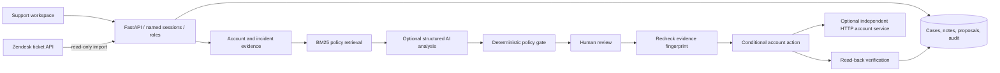

# Architecture and decisions

## Workflow

## Trust boundaries

- Ticket text is untrusted. It cannot choose credentials, endpoints, database queries or executable tools.
- Account state and the versioned server policy determine the authorized action. AI produces a schema-validated diagnosis and reply; unsupported actions, invalid citations and policy disagreements fall back.
- Operators create and investigate. Reviewers additionally approve, close/reopen, import and inspect workspace activity. Named identities appear in audit records.
- Passwords use salted scrypt; only hashed session tokens are stored. Sessions expire after eight hours and can be revoked. Development role tokens can be disabled.
- Browser rendering uses text nodes, not HTML from tickets or model output. Credentials remain in memory. CSP restricts script/style sources; CSV formula prefixes are escaped.
- This is one workspace, not a multi-tenant service. SQLite transactions serialize mutations; a single application instance is the intended deployment.

## Execution reliability

Local mode atomically updates permission, verifies it and records the approval. Proposals include a SHA-256 fingerprint of all decision evidence. Changed evidence, closed cases, superseded proposals and contradictory decisions cannot execute.

Remote mode uses an authenticated account API. It independently checks the fingerprint and policy inside its own transaction, then stores the result under a workspace-specific operation key. An execution intent is committed locally before the remote mutation. A timeout, malformed response, or process interruption therefore leaves a durable `execution_unknown` state. Each proposal is also bound to its original account integration. Retrying approval retrieves the remote result and reconciles the case. Do not create a replacement operation to work around uncertainty.

Manual case closure is distinguished from verified resolution. An already-enabled permission escalates instead of incorrectly claiming that the symptom is fixed. Reopening preserves earlier history.

## Data model

`accounts` → `members` → `tickets` → `investigations`; each case also has `notes` and `audit` records. `users` and hashed `sessions` provide identity. `imports` deduplicates external source IDs. Schema changes add missing columns without deleting existing records. The reference account service owns a separate database and operation ledger.

## Deliberate choices

- A small, versioned policy corpus with BM25 is transparent and reproducible; vector infrastructure is unnecessary for five policies.
- The AI workflow is bounded evidence analysis, not a free-running tool loop. Fixed evidence collection makes unsupported actions easier to prevent and evaluate.
- No external message sending or billing modification is implemented. Replies remain reviewable drafts.
- No forced frontend framework: native browser modules and CSS keep setup small, while API and integration boundaries remain independently testable.
- Request IDs and timing are logged without bodies or credentials. Audit history is application-controlled, not tamper-proof against a database administrator.

## External validation still required

Real model-account calls, a customer's integration credentials, production security review, meaningful load testing and support-practitioner feedback are separate validation activities. Synthetic tests must not be presented as customer outcomes.
